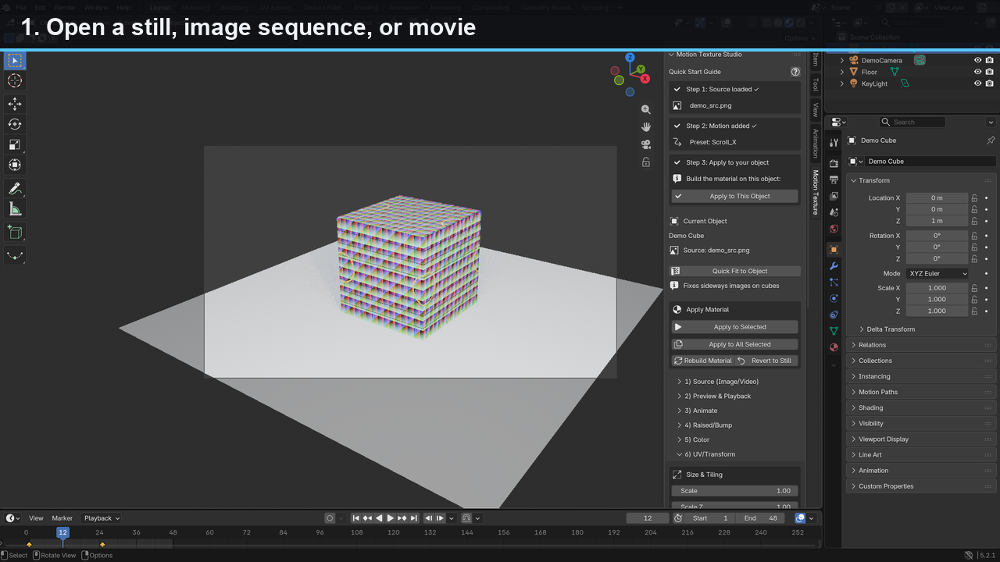

# Motion Texture Studio

**Midterm project — Programming for Animators.** A Blender 5.2 add-on that turns the Week 5 **Texture GUI** (`texture_gui.py`, v1.8.0) into a motion-texture tool.

**Repo:** https://github.com/ikao1/Motion-Texture-Studio  
**Demo (77 s):** [assets/motion_texture_studio_demo.mp4](assets/motion_texture_studio_demo.mp4)

## The tool in one sentence

Motion Texture Studio is a Blender add-on that turns the existing Texture GUI into an animation tool: it maps stills, image sequences, and movies onto the selected object, animates every texture and relief control over time, and previews the moving surface live in the viewport.

**App:** Blender 5.2 LTS. It lives in the 3D Viewport sidebar (`N`) under the tab **Motion Texture**.

## The chore it ends

Today, putting moving imagery on a surface means building the shader by hand: wiring an Image Texture node, switching it to Image Sequence or Movie, setting frame range and cyclic playback, keyframing mapping offset/rotation, adding a bump or displacement node, keyframing the relief, checking playback, and redoing all of it when the art changes. That is roughly **45–90 minutes per asset**, repeated every revision. My current Texture GUI only handles still images and one surface at a time. This tool collapses the job to **open source → choose motion → preview → apply**, in minutes.

## The UI

Sidebar tab **Motion Texture** (`N`), collapsible sections:

- **Source**
  - `Still`, `Sequence`, `Movie` buttons, `Recent` menu, `Folder` (reveal source)
  - source path field, `Refresh Source`, `Clear Source`
  - Frame Start, Frame End, FPS fields (frame range auto-detected from the filenames)
  - Frame Offset field, Loop Mode menu (Once, Loop, Ping-Pong), Color Space menu (sRGB, Non-Color, Linear)
  - frame count / resolution readout, `Auto-Fit UVs` toggle (on by default)
  - EXIF orientation is applied automatically for still photos; MP4/MOV display-matrix rotation is applied automatically for videos
  - With `Auto-Fit UVs` on, opening a source on a cube auto-rewrites its UVs so the image fills every face upright
- **Playback**
  - `Play/Pause`, `Previous Frame`, `Next Frame`, Current Frame field, timeline scrubber
  - Scene Start / End fields, `Preview on Selected` toggle, `Preview Render`
  - `Bake Frame` and `Bake Sequence` — save the animated surface as PNGs next to the source
- **Animate Texture**
  - `Enable Animation` toggle
  - **Speed** menu (0.25x–4x) — presets key one cycle whose length Speed chooses (24 frames at 1x), and a CYCLES modifier repeats it for a shot of any length
  - **On Twos** toggle + Hold Frames — stepped, stop-motion playback of every animated value
  - Motion preset buttons (Scroll X, Scroll Y, Drift, Pulse, Breathe, Ripple, Flicker), with the active motion shown underneath
  - `Key at Frame`, `Delete Key`, `Clear Animation`, Interpolation menu, `Copy Still Values to Frame 1`
  - **Batch Offset** (frames) + `Apply to All` — every selected object gets the same animation, staggered so a row ripples
- **Raised Surface**
  - Relief Mode menu (Bump, Displacement)
  - Relief Source menu (Image Luminance, Image Sequence, Noise, Wave)
  - `Animate Relief` toggle, Relief Amount, Depth, Midlevel, Detail, Detail Scale, Invert Relief
  - Motion Direction menu (X, Y, Radial), Speed, Amplitude, Phase Offset
  - `True Displacement` toggle, Subdivision Level slider
  - Normal Map field + `Load Normal Map…`, Normal Strength
  - Raised presets: Drift, Pulse, Ripple, Crawl, Breathe
- **Transform**
  - Scale, **Scale Z**, Tiling X/Y
  - **Rotation X/Y/Z** (X/Y tilt, Z with -90°/+90° buttons)
  - **Offset X/Y/Z**, Flip X/Y
  - **Reset Transform** — restore scale, tiling, rotation (X/Y/Z), offset (X/Y/Z), scale Z, and flips to defaults
  - **Clean Up Materials** — assign the Motion Texture material to all faces and remove unused material slots (fixes stray default materials)
  - `Fit to Object` — rewrite the object's UVs so the image fills every face upright (`Every Face`) or a single front face (`Front`). Use this on cubes and multi-face objects, where a single image otherwise shows sideways or split across the default UV islands
- **Surface** (kept from v1.8, expanded)
  - Base: Roughness, Metallic, Specular, IOR, Diffuse Roughness, Specular Tint
  - Clear Coat: Coat, Coat Roughness, Coat IOR, Coat Tint
  - Fabric Sheen: Sheen, Sheen Roughness, Sheen Tint
  - Anisotropy: Anisotropic, Anisotropic Rotation
  - Subsurface: Weight, Scale, IOR, Anisotropy
  - Glass & Thin Film: Transmission, Alpha, Thin Wall, Thin Film Thickness, Thin Film IOR
  - Glow (emission strength), Glow Tint, `Glow From Image` toggle, plus Glow Gain and Glow Threshold when masking
  - 19 Surface Presets: Matte, Glossy, Plastic, Ceramic, Metal, Brushed, Velvet, Glass, Glowing, Toon, Rubber, Skin, Wax, Marble, Chrome, Gold, Hologram, Car Paint, Bubble
- **Apply / Settings**
  - `Apply to Selected`, `Apply to All Selected`, `Revert to Still`, `Rebuild`
  - `Save Motion Preset…`, `Load…`, `Rename…`, `Delete…`, `Import…`, `Export…`
  - Reset menu (Color, Transform, Surface, Animation, Everything)
  - Main panel guides the first steps: open a source → pick a motion preset

## Why it's advanced

- Real **animation system**, not a single script: keyframes and drivers on node inputs, synced to the scene timeline, with loop modes, frame offsets, and interpolation.
- Handles **moving images** as a source: image sequences and movies with frame ranges, offsets, cyclic playback, and per-object timing.
- **Moving raised textures**: animated bump and optional true displacement, driven by image luminance, sequences, or procedural motion. Bump is the fast fallback; displacement is the heavy option.
- **Non-destructive preview**: edits run live in Material Preview; nothing is baked until you press Bake. `Preview Render` checks the current frame or range.
- Works on **whatever is selected**, with batch apply and per-object settings; remembers the last source, preset, and motion setup.
- **Presets saved to disk** as portable JSON (motion + surface), with optional thumbnail; can be imported/exported and shared.
- **Blender's native undo/redo** covers every operator, so no custom Undo buttons are needed; automatic stale-node-graph rebuild is carried over from v1.8.
- **Handles mistakes without crashing**: missing/corrupt frames, unsupported codec, start frame after end frame, missing normal map, and unsupported true displacement all produce a clear warning and a safe fallback.
- **Bakes to a portable image sequence** so the animated texture can leave Blender and be handed off.

## How it works: one function to walk through

`_apply_motion_preset(obj, context, preset)` in `motion_texture_studio.py:1844` is the animation system in miniature:

1. **Find or build the graph.** It calls `_apply(context, rebuild=False, obj=obj)`, which creates the per-object material and node graph if needed, then gets the material with `_find_material(obj)`. A preset never operates on a half-built graph.
2. **Clear the old animation.** `_reset_preset_curves(obj)` calls `animation_data_clear()` on the material node tree so a new preset re-keys cleanly instead of stacking on the previous one. (This also replaces hand-keyed material animation.)
3. **Read the timing.** `_cycle_frames(s)` turns the Speed menu into a cycle length; at 1x it is 24 frames, so keys land at frame 1 and frame 25, with a midpoint at 13 for presets that need one.
4. **Key node sockets, not the object.** For Scroll X it writes `MT_Map.Location` at frame 1 `(0,0,0)` and frame 25 `(1,0,0)` with `_key_socket`. The keys live on the material node tree's action, so the object's own transform and armature animation are untouched.
5. **Repeat forever.** `_refresh_fcurve_modifiers` removes and rebuilds a `CYCLES` modifier on every curve (and a `STEPPED` modifier when On Twos is on). The cycle is 24 frames long, but it repeats for a shot of any length, which is why the scene end frame does not matter.
6. **Keep the state consistent.** It sets `s.enable_animation = True` and `s.last_motion_preset` inside `_suspend_updates()`, so UI update callbacks do not recursively rebuild while the keys are being written.
7. **Blender 5.2 actions.** `_iter_fcurves` walks `action.layers` and channel bags when present, so the same code works with 5.2's layered actions and older flat actions.

The important design choice is that a preset is **data on node sockets**, not a particle system or a video texture. That is why Speed, On Twos, batch offset, and baked PNGs compose without special cases.

## The three weeks

| Milestone | Deliverable |
| --- | --- |
| **By Oct 13** | Existing Texture GUI v1.8 is the baseline: still-image path, surface presets, drag-and-drop, node rebuild. New: source manager for image sequences/movies; scene-synced playback; basic animated offset/rotation; live preview. |
| **By Oct 20** | Keyframes and interpolation for all texture/surface controls; moving raised surface (bump + optional displacement) with motion presets; per-object settings; save/load motion presets. |
| **By Oct 26** | Bake current frame and motion-to-sequence; batch apply; undo/redo; loop/offset edge cases; missing-file recovery; performance/cache pass; 2–3 demo assets; README + 60-second recording. |

## The smallest version that still counts

Load one image sequence or movie onto the selected object, animate Offset X/Y (scroll) and Relief/Depth (pulse) on the timeline, and preview the playback. No presets, no batch, no bake — still a real upgrade over the still-only v1.8 and enough to demo.

## The riskiest part

Frame-accurate, non-blocking playback and caching of movie/image-sequence textures while the material graph rebuilds, plus **true displacement** support/performance in EEVEE. Bake is the second risk.

- **Fallback:** prefer image sequences over compressed movies, ship animated **bump** as the primary “raised” look, bake only the current frame, and use proxy/reduced-resolution playback. If displacement is unreliable, keep it as an optional Cycles path and label it clearly.

---

# Install and run

## What you need

- **Blender 5.2 LTS** (tested on 5.2.1 LTS). Blender 4.2+ should also work but has not been tested.
- The file `motion_texture_studio.py` from this repo (no other install, no dependencies).

## Steps

1. Clone this repo: `git clone https://github.com/ikao1/Motion-Texture-Studio.git` or download the ZIP.
2. Open Blender. Go to **Edit → Preferences → Add-ons**.
3. Click the **⌄** (dropdown) at the top right → **Install from Disk…**.
4. Select **`motion_texture_studio.py`** from the cloned repo.
5. Tick the checkbox next to **Motion Texture Studio** to enable it.
6. In the 3D Viewport press **N** to open the sidebar and click the **Motion Texture** tab.
7. Select a mesh object (the default cube is fine). Click **Open Still…** and choose **`assets/test_texture.png`** or **`assets/demo_texture.png`**.
8. Click **Apply to Selected**. The object now has a material called `MotionTexture_<objectname>`.
9. Open the **Animate Texture** section and click a motion preset such as **Scroll X**. Set the scene end frame to ~48 and press **Play/Pause** — the texture scrolls in the viewport.
10. For a sequence: **Open Image Sequence…** and pick `assets/demo_sequence/frame_0001.png`. The frame range is detected from the filenames (12 frames here).
11. For a movie: **Open Movie…** and pick a video file.

If a movie or sequence codec will not load, use an **image sequence** instead — it is the more reliable path.

## Verified from a fresh clone

I tested the add-on from a clean clone in a throwaway Blender configuration (Blender 5.2.1 LTS, macOS) with the checked-in harness:

```bash
BLENDER_USER_CONFIG=/tmp/mts-config \
BLENDER_USER_SCRIPTS=/tmp/mts-scripts \
/Applications/Blender.app/Contents/MacOS/Blender -b --factory-startup \
  --python tools/verify_fresh_clone.py
```

The harness installs `motion_texture_studio.py`, enables it, and runs 22 checks; all pass. It covers Install from Disk, enabling, the sidebar property group, Apply, the material and UVs, Scroll X keys and CYCLES, animated offset, Fit to Surface, image-sequence range detection, and preset save/load. The GUI path — Install from Disk, sidebar, Quick Start, and Bake — was run separately in the same Blender version and is what the demo video records.

## Demo video and 5-minute walkthrough

[](assets/motion_texture_studio_demo.mp4)

The 77-second MP4 is in `assets/` and is a screen capture from Blender 5.2.1: open a still, apply Scroll X, play the cycle, show animated bump, load an image sequence, and bake a frame. If GitHub renders the link as a download, the poster above is a frame from the video.

**5-minute run of show**

1. **Fresh clone + install** (1 min): `git clone` the repo, Install from Disk, enable, open the sidebar.
2. **Still → motion** (1 min): open `assets/test_texture.png`, Apply, click Scroll X, press Play; change Speed to show the cycle re-key.
3. **Surface** (1 min): Fit to Object → Every Face; Raised Surface → Bump + Pulse; keep True Displacement off for EEVEE.
4. **Sequence** (1 min): open `assets/demo_sequence/frame_0001.png` and show the auto-detected 12-frame range; play.
5. **Bake** (30 s): Bake Frame and open the PNG next to the source.
6. **Code** (30 s): walk through `_apply_motion_preset` (above) — node-socket keys plus a CYCLES modifier.

# What works right now

- Installs and registers as a Blender add-on; sidebar tab **Motion Texture** opens. Verified in Blender 5.2.1 in both background and GUI modes.
- **Blender 5.2 compatibility:** the sidebar icons are valid in 5.2, and Bake works even when the scene output is set to Video.
- Per-object material named `MotionTexture_<object>` with a full non-destructive node graph.
- **Sources:** still image, numbered image sequence (auto frame range), movie, drag-and-drop, recent-sources menu; EXIF orientation corrected for photos and MP4/MOV display-matrix rotation corrected for videos (portrait phone clips show upright).
- **Fit to Object:** one-click UV rewrite so a single image/video fills a cube's faces upright instead of showing sideways or split across the default UV islands.
- **Playback:** play/pause, frame step, scrub, preview render, scene-synced timeline.
- **Loop modes:** Once, Loop (cyclic), Ping-Pong (mirrored playback for sequences and movies).
- **Speed:** one menu sets the cycle length of every preset — 96/48/24/16/12/6 frames; the CYCLES modifier repeats the cycle for a shot of any length, so the scene range never matters. Re-keying a preset after a Speed change keeps the modifiers.
- **On Twos:** stepped playback (hold 1–6 frames) on every animated value, for stop-motion feel.
- **Motion presets:** Scroll X/Y, Drift, Pulse, Breathe, Ripple, Flicker (noise-driven, never repeats). Relief presets: Drift, Pulse, Ripple, Crawl.
- **Animation:** keyframe offset/rotation/scale/hue/brightness/contrast/relief/depth/glow, delete key, clear animation, linear/bezier/constant interpolation, copy still to frame 1, key at current frame.
- **Raised surface:** animated bump; relief source from image / noise / wave; amplitude and phase.
- **True displacement:** optional, via a displacement output + subdivision modifier, with clear warning that it is heavy and best on Cycles.
- **Color / transform / surface / emission** controls with per-material Hue Color Ramp and Remap blend.
- **Bake:** current frame and the whole source range to PNG files next to the source image.
- **Batch apply:** copies settings *and* animation curves to every selected object, staggered by Batch Offset frames.
- **Save / load / rename / import / export** motion presets as JSON in Blender’s user presets folder.
- **Apply to Selected**, **Rebuild**, **Revert to Still**, guided main panel.

# What does not work yet

- **Per-preset thumbnails** are not implemented (presets show names only).
- **Movie auto-duration** depends on the codec loading correctly; image sequences are more reliable.
- **True displacement** is unreliable in EEVEE and should be used on Cycles. Bump is the safe path.
- **Interactive polish** is still rough: the sidebar is long, some menus need scrolling, and the layout assumes a wide sidebar. It was verified in the GUI, but not tuned for small windows.
- **Bake renders the current camera view with Blender's OpenGL renderer**, not an isolated texture atlas. It writes the whole scene as seen, so hide helpers and frame the object before baking.
- **Multi-material characters:** Apply adds the `MotionTexture_<object>` material but does not reassign existing faces. Use a dedicated surface object, or Clean Up Materials, which replaces the object's material slots.
- **Character animation:** the tool animates the material and an optional displacement modifier, not a rig. It can own a skinned mesh's material, but it is designed for props, surfaces, and environment pieces.

# What I'd build next

- **Per-preset thumbnails** for saved motion presets
- **More animation curves/easing** options (custom easing graphs)
- **Improved UV projection tools** (Project from View, Pack Islands) for modeling workflows
- **Better movie codec handling/proxies** for more reliable playback
- **A bake that isolates the object or exports a texture-space atlas**, instead of the current camera-view OpenGL render

# Peer run (A6)

**Classmate:** Brent Shultz (A6: Wire Body Profile - InBody Data Build)

1. **What they did:** I cloned Brent's repo, opened `InBody Data Build.mb` in Maya 2027, launched the Wire Body Profile UI manually (`import body_profile_ui; body_profile_ui.show()`), and entered dated measurements to build a profile.
2. **What happened:** Everything worked as described — saving entries, loading history, deleting entries, rebuilding the wire body, and using the slider to reshape the figure all functioned correctly. The window had to be launched manually and required Maya 2027 specifically.
3. **What confused or broke:** The UI didn't auto-launch on scene open, requiring manual import/run.

**What I fixed:** I launched the module directly from the Maya Script Editor (`import body_profile_ui; body_profile_ui.show()`), then re-ran save, load, delete, rebuild, and the slider to confirm the tool was solid once opened. The peer run also pushed me to re-check my own install path; that check found and fixed two Blender 5.2 regressions in Motion Texture Studio — invalid sidebar icons that raised a draw error, and Bake failing when the scene output was set to Video.

## Build history

The earlier prototype lives in [`ikao1/pfa_week_5`](https://github.com/ikao1/pfa_week_5) (Week 5 Texture GUI), and the midterm checkpoint/peer run is in [`ikao1/Midterm-checkpoint-peer-run`](https://github.com/ikao1/Midterm-checkpoint-peer-run). This repo continues that work; the commit dates show the build across the three weeks.
